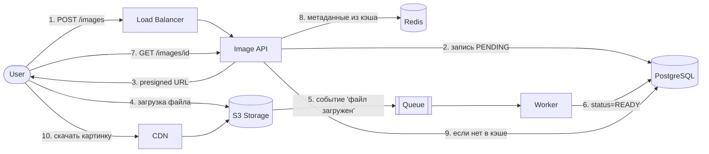

# Image Hosting (Metadata Service)

Сервис хранения и раздачи метаданных изображений для высоконагруженного окружения[cite: 1].

## Требования к системе
* **Функционал:** Загрузка картинок в S3-совместимое хранилище, хранение метаданных и выдача по ссылке[cite: 1].
* **Нагрузка:** ~2 000 RPS на чтение / 50 RPS на загрузку[cite: 1].
* **Объем данных:** 20 млн файлов[cite: 1].
* **SLA / Latency:** p99 получения метаданных < 100 мс[cite: 1].

## Архитектура и схема работы

Тяжелый трафик (бинарные файлы картинок) отделен от API-сервера: загрузка идет напрямую в S3 по Presigned URL, а раздача — через CDN[cite: 2]. Чтение метаданных ускорено за счет кэширования в Redis по паттерну Cache-Aside[cite: 2].



### Пошаговый флоу:
1. **Запрос на загрузку:** Клиент отправляет `POST /images` через Load Balancer в `Image API`[cite: 2].
2. **Инициализация метаданных:** `Image API` сохраняет запись в `PostgreSQL` со статусом `PENDING`[cite: 2].
3. **Получение ссылки:** Сервис возвращает клиенту сгенерированный `presigned URL` для прямой загрузки[cite: 2].
4. **Прямая загрузка в S3:** Клиент загружает файл напрямую в `S3 Storage`, минуя бэкенд[cite: 2].
5. **Уведомление о загрузке:** После сохранения файла `S3 Storage` отправляет событие `'файл загружен'` в очередь (`Queue`)[cite: 2].
6. **Асинхронная обработка:** Фоновый `Worker` читает событие из очереди, обновляет статус записи в `PostgreSQL` на `status=READY` и инвалидирует кэш[cite: 2].
7. **Запрос метаданных:** Клиент запрашивает метаданные картинки через `GET /images/{id}`[cite: 2].
8. **Чтение из кэша (Cache Hit):** `Image API` проверяет наличие метаданных в `Redis` и сразу отдает их при наличии (обеспечивая p99 < 100 мс)[cite: 1, 2].
9. **Чтение из БД (Cache Miss):** Если данных нет в кэше, `Image API` запрашивает их из `PostgreSQL` и сохраняет в `Redis`[cite: 2].
10. **Скачивание файла:** Клиент скачивает саму картинку по ссылке через `CDN`, который при необходимости забирает оригинал из `S3 Storage`[cite: 2].

## Структура проекта

```text
image-hosting/
├── cmd/api/main.go             # Точка входа и запуск HTTP-сервера
├── internal/
│   ├── models/image.go         # Модель метаданных и статусы (PENDING, READY)
│   ├── repository/postgres.go  # Мок PostgreSQL
│   ├── repository/redis.go     # Мок Redis (Cache-Aside)
│   ├── service/image.go        # Бизнес-логика, очередь (Queue) и фоновый Worker
│   └── handler/http.go         # HTTP-хендлеры
└── go.mod
```

## Запуск и тестирование

Запуск сервера:
```bash
go run ./cmd/api/main.go
```

### Примеры запросов (PowerShell)

**1. Создание записи и получение Presigned URL (Шаги 1–3):**
```powershell
curl.exe -X POST http://localhost:8080/images -d '{\"filename\":\"photo.jpg\"}'
```

**2. Загрузка файла в S3 по Presigned URL (Шаги 4–6):**
```powershell
curl.exe -X PUT http://localhost:8080/s3/upload/img_12345 -d "binary_image_content"
```

**3. Получение метаданных (Шаги 7–9):**
```powershell
curl.exe -i http://localhost:8080/images/img_12345
```